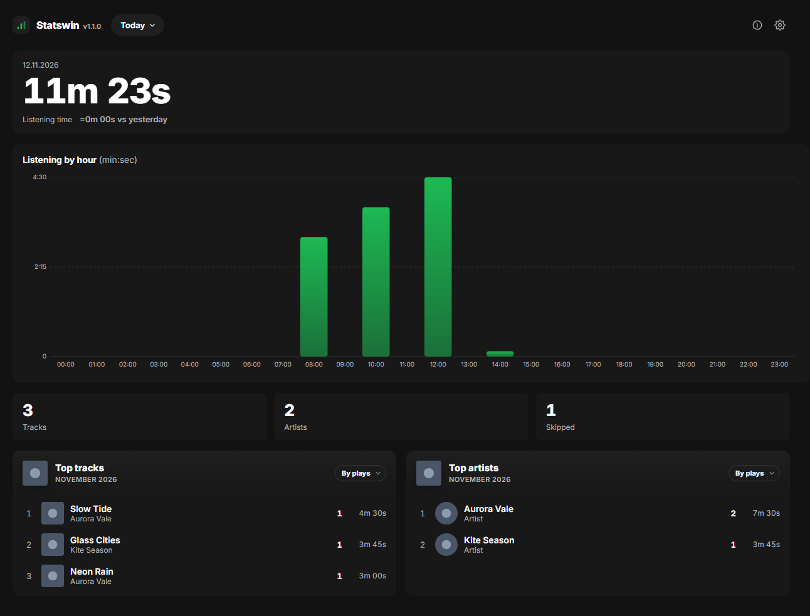
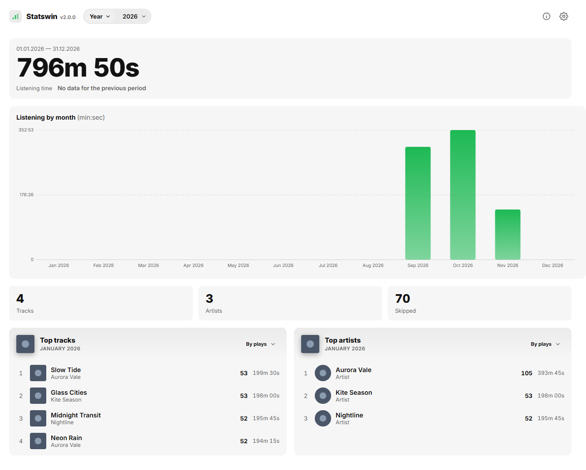
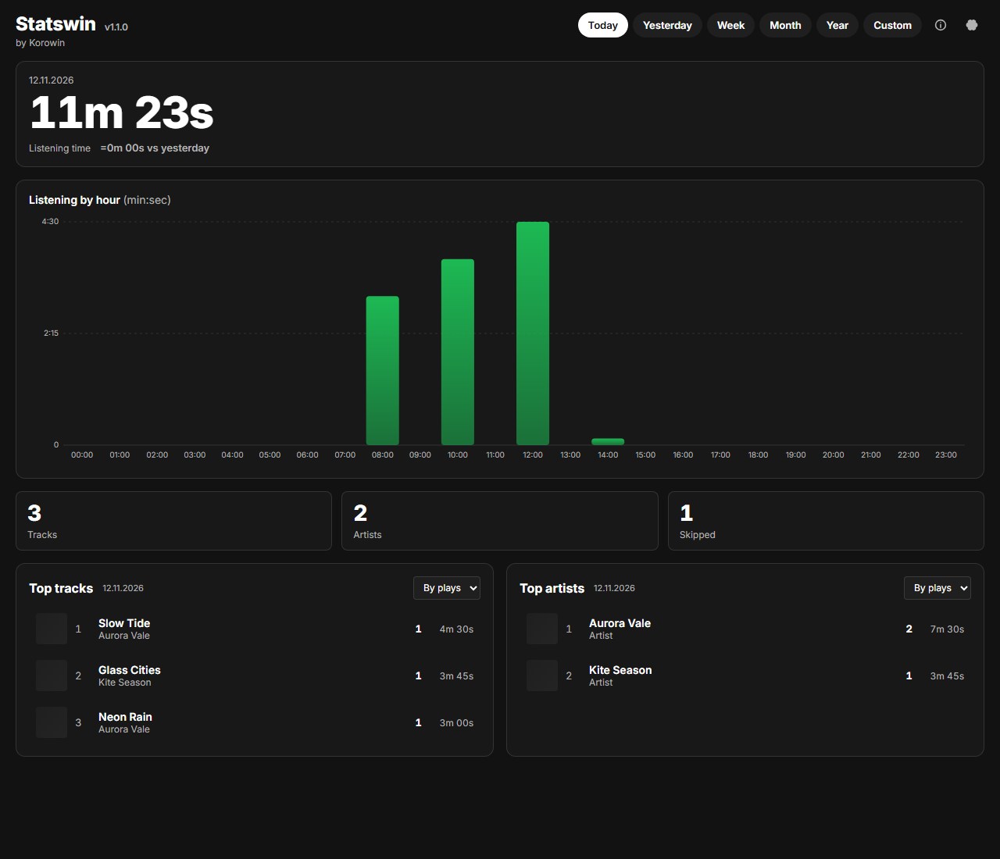
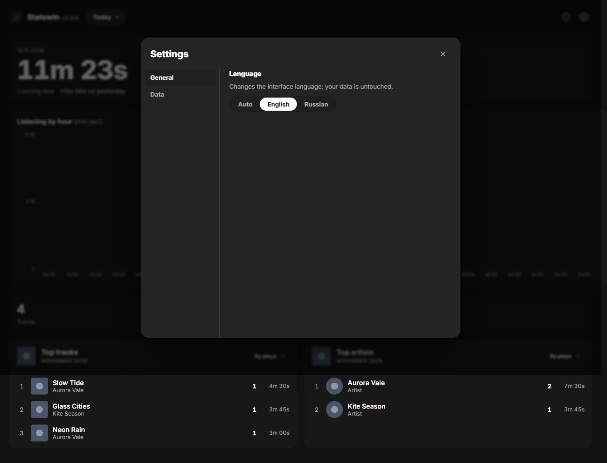
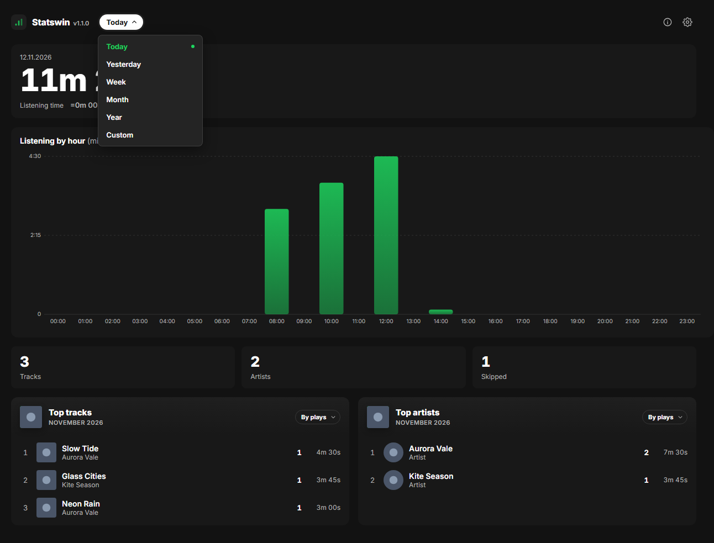
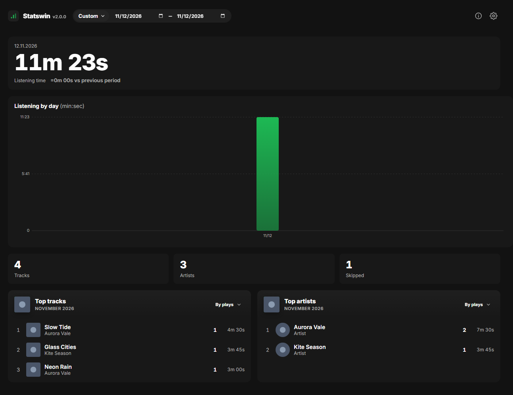

# Statswin

[](https://github.com/korovagg/Statswin/releases)
[](LICENSE)
[](https://github.com/korovagg/Statswin/commits/main)

Detailed listening stats inside Spotify — listening time, track and artist counts,
skipped tracks and top lists in one place.

Statswin is a [Spicetify](https://spicetify.app) CustomApp plus a small extension that
records what you listen to locally. Nothing leaves your machine.

## What's new in 2.0

- **New storage engine.** Detailed sessions are kept for 90 days; older days are
  compacted into daily totals, so history no longer fills up Spotify's storage.
  Existing data is migrated on first launch and the legacy reset flag is deleted.
- **Accurate time tracking.** Listening time is measured by the player clock;
  pauses, seeks and background tabs no longer add or drop minutes.
- **Album covers** in the top lists, resolved from the current Spotify client.
- **Reworked interface**: one-row header with a period menu, themed dropdowns,
  permission-aware settings dialog, sticky header.
- **Auto language.** Statswin follows the Spotify client language until you pick
  one explicitly in Settings → General.
- **Safer import/export** with merge/replace modes and duplicate skipping.

## Screenshots

| Today | Year |
| --- | --- |
|  |  |

| Top lists | Settings |
| --- | --- |
|  |  |

| Period menu | Custom range |
| --- | --- |
|  |  |

Screenshots are generated with Playwright from the production bundle — see
[docs/screens/README.md](docs/screens/README.md).

## Install

### One-click (recommended)

**Windows** — open PowerShell:

```powershell
iwr -useb "https://raw.githubusercontent.com/korovagg/Statswin/main/install_windows.ps1" | iex
```

**macOS / Linux** — open a terminal:

```bash
curl -fsSL "https://raw.githubusercontent.com/korovagg/Statswin/main/install_linux.sh" | bash
```

### Manual

1. Download the latest `statswin-v*.zip` from
   [Releases](https://github.com/korovagg/Statswin/releases).
2. Extract the `statswin` folder into your Spicetify `CustomApps` directory:
   - Windows: `%APPDATA%\spicetify\CustomApps`
   - macOS / Linux: `~/.config/spicetify/CustomApps`
   - Not sure? `spicetify config-dir` prints the root folder.
3. Activate the app and restart Spotify:

   ```bash
   spicetify config custom_apps statswin
   spicetify apply
   ```

4. Open **Statswin** from the Spotify navigation bar.

## Updating

Re-run the one-click installer, or replace `CustomApps/statswin` with the contents of
the newest release zip and run `spicetify apply`. Existing statistics are migrated
automatically and kept.

## Data and privacy

- Everything is stored locally in Spotify's browser `localStorage`.
- Detailed sessions are kept for **90 days**; older days are compacted into daily
  totals (listening time remains complete, track/artist counts only cover the last
  90 days).
- Playback is recorded by wall-clock time; a track counts as skipped when it was
  listened to for less than 10 seconds.

## Backup, import and reset

The settings dialog (gear icon) offers:

- **Backup** — downloads a JSON file with sessions, the track registry and daily totals.
- **Import** — validated import with **Merge** / **Replace** modes and an option to
  skip duplicates. Both v3 backups and legacy v2 exports are accepted.
- **Download diagnostics** — exports the in-memory debug log (no track metadata).
- **Reset statistics** — wipes all stored listening data.

## Development

Requirements: Node.js 18+ (Node 20 recommended).

```bash
npm ci                 # install dependencies
npm run typecheck      # tsc --noEmit
npm run build-local    # build dist/ (index.js, extension.js, style.css, manifest.json)
npm run build-release  # package release/statswin + release/statswin-v<version>.zip
npm run test:counters  # counter arithmetic checks (plays, skips, ranges)
npm run screenshots    # optional: regenerate docs/screens (needs playwright)
```

`npm run watch` builds into your Spicetify folder on change.

For manual testing, copy `dist/*` into `%APPDATA%\spicetify\CustomApps\statswin`
(`~/.config/spicetify/CustomApps/statswin` on Linux/macOS) and run `spicetify apply`.

### Releases

Tagging `v*` (for example `v2.0.0`) triggers
[`.github/workflows/release.yml`](.github/workflows/release.yml), which builds the zip and
publishes it as a GitHub release. Pull requests run `typecheck` + `build-local` via
[`.github/workflows/ci.yml`](.github/workflows/ci.yml).

## Uninstall

1. Close Spotify.
2. Delete `CustomApps/statswin`.
3. Run `spicetify config custom_apps statswin-` and `spicetify apply`.
4. Relaunch Spotify.

Statistics live in Spotify's `localStorage`; clearing that storage (or using the reset
button in the app beforehand) removes them.

## Contributing

Bug reports and pull requests are welcome:
[issues](https://github.com/korovagg/Statswin/issues).

## License

[MIT](LICENSE) © 2025 Korowin
